# BIT 4131 reproducible results (Python)

Dataset: [`student_performance.csv`](../../data/student_performance.csv) (240 synthetic records). Results and figures were generated by [`run_all.py`](../../python/run_all.py); see the [topic guide](../../docs/topic_guide.md) for assumptions, theory, and equations. These are educational examples, not real-student findings.

## 1. Measures of central tendency and dispersion

n=240; mean=67.722; median=67.955; mode=61.80; sample variance=132.549; SD=11.513; Q1=59.27; Q3=76.89; IQR=17.62. The median and IQR are robust summaries; compare mean and median when describing skew.

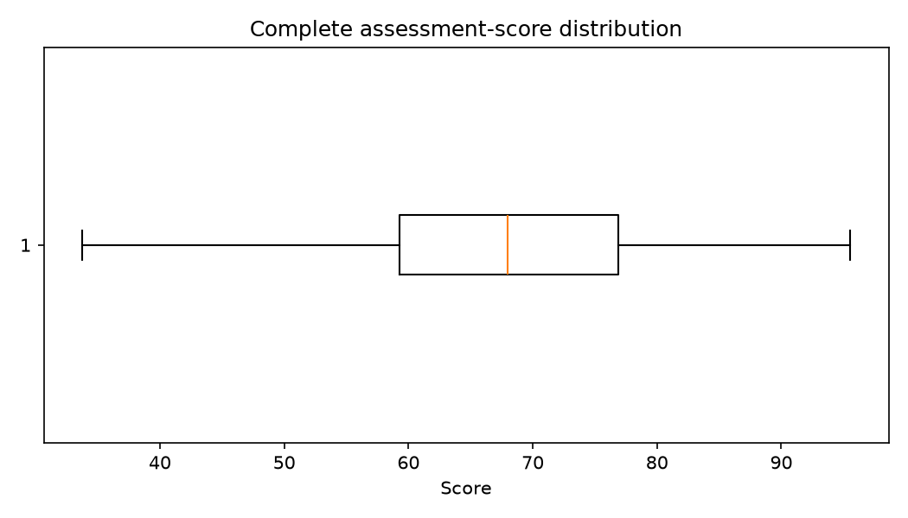

## 2. Probability and conditional probability

P(pass)=0.7434; P(pass | group B)=0.7647; 10,000-trial simulated proportion=0.7399. The simulated rate should be close to the observed rate, with remaining variation due to Monte Carlo sampling.

## 3. Probability distributions

Fitted normal mu=67.892, sigma=11.462; fitted P(score <= 60)=0.2455. Compare the curve with the histogram; the normal model is an approximation to bounded scores.

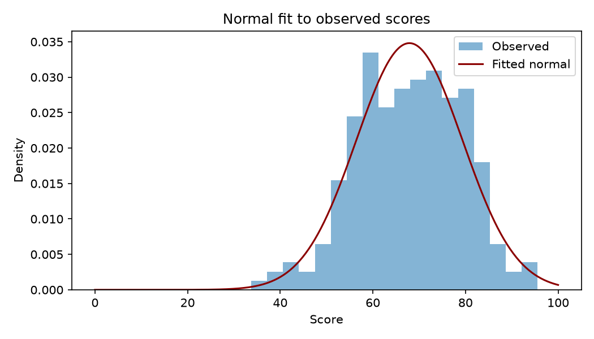

## 4. Sampling distributions and Central Limit Theorem

5,000 resamples of size 30: mean of sample means=67.764; simulated SE=2.075; theoretical SE=2.102. The sampling distribution is more concentrated and approximately normal.

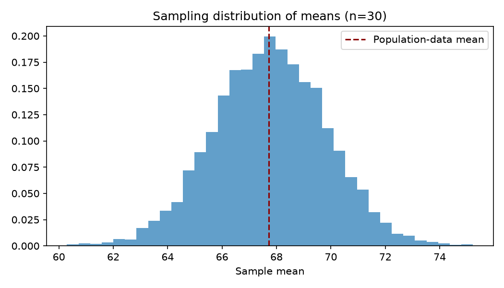

## 5. Confidence intervals

Mean=67.722; 95% t interval=(66.258, 69.186); under the sampling assumptions, this method has 95% long-run coverage for the population mean.

## 6. Hypothesis testing

H0: mean score=60; t(239)=10.3902; two-sided p=4.14597e-21; alpha=0.05: reject H0. This is evidence relative to H0, not proof about an individual student.

## 7. Correlation and covariance

Complete pairs n=230; covariance=20.8861; Pearson r=0.7034. A positive association is not evidence that study hours alone caused score differences.

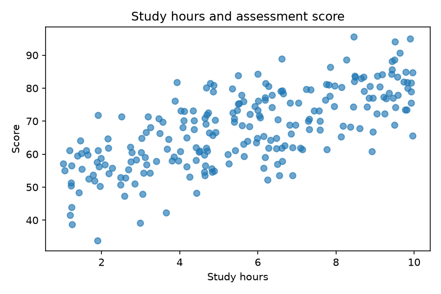

## 8. Linear regression and least squares

n=230; equation: score=27.773 + 3.329*study_hours + 0.277*attendance; p-values (intercept, hours, attendance)=(4.36e-16, 8.565e-44, 1.01e-12); R^2=0.5964; residual SD=7.372. Slopes are adjusted associations.

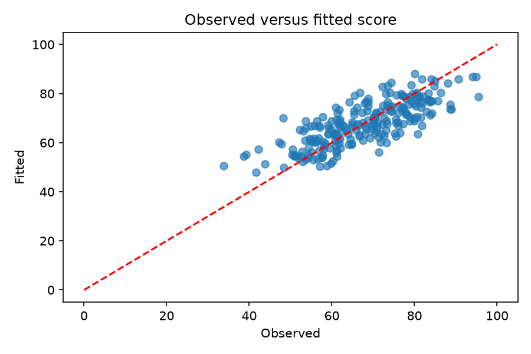

## 9. Matrix algebra in statistics

A+B=[[3. 5.]
 [3. 3.]]; A@B=[[4. 8.]
 [7. 4.]]; A.T=[[2. 1.]
 [1. 3.]]; det(A)=5.000; inverse(A)=[[ 0.6 -0.2]
 [-0.2  0.4]]; solution of A x=b is [1.6 1.8]; residual norm=0.00e+00. Regression normal-equation coefficients (intercept, hours, score for attendance)=[43.9945 -2.8952  0.7256].

## 10. Eigenvalues, eigenvectors and PCA

Explained variance ratios=[0.5714 0.3561 0.0725]; eigenvalues=[1.7216 1.073  0.2184]; eigenvectors/components (rows)=[[ 0.6858  0.1254  0.7169]
 [-0.3038  0.9445  0.1254]
 [-0.6613 -0.3038  0.6858]]. Standardization prevents the original units from dominating PCA.

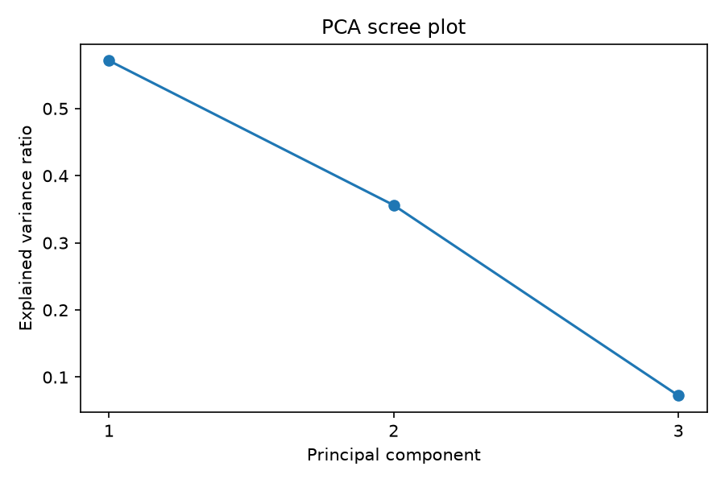

## 11. Numerical optimization

Converged=True; message=Optimization terminated successfully.; intercept=50.0127; slope=3.1621; sum of squared errors=15441.184; closed-form intercept/slope=(50.0127, 3.1621).

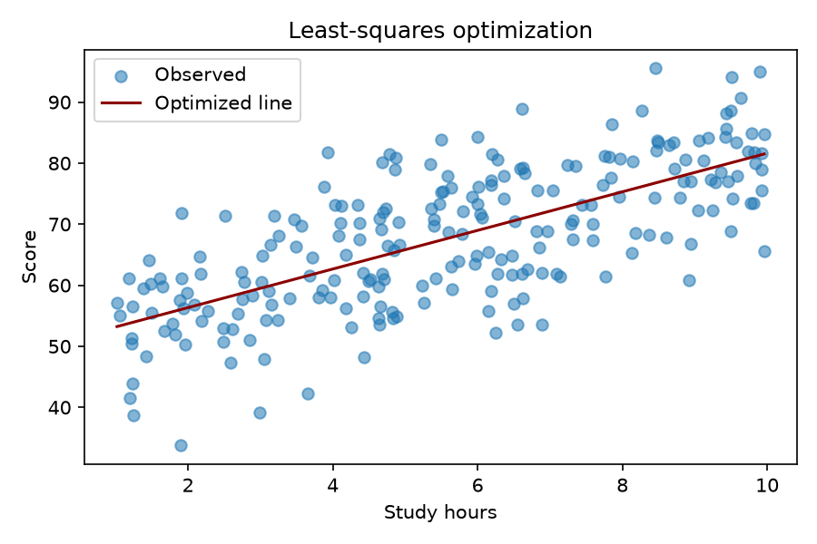

## 12. Random numbers and Monte Carlo methods

N=50000; estimate pi=3.147280; approximate MC SE=0.007326.

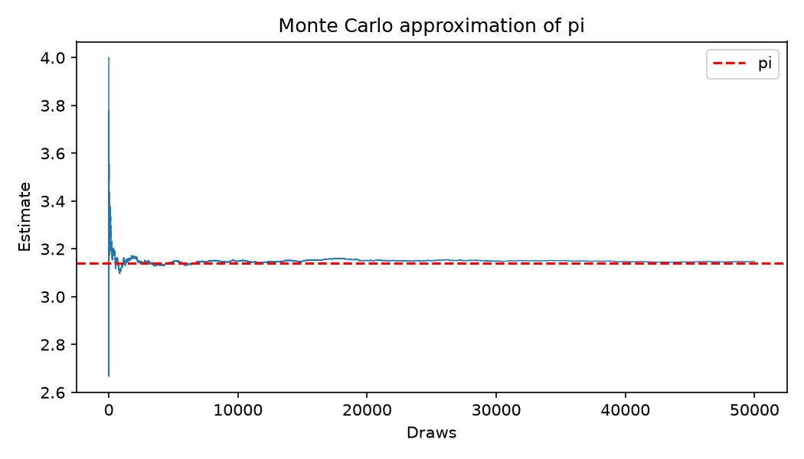

## 13. Time-series analysis

Monthly observations=24; first=2024-01-01, last=2025-12-01; trend=0.0384 score/month (p=0.7013); lag-1 autocorrelation=-0.0741; calendar-month mean-score range=63.35 to 72.93; next-month linear-trend forecast=68.20. The linear trend is not statistically detectable at alpha=0.05. Forecast is illustrative.

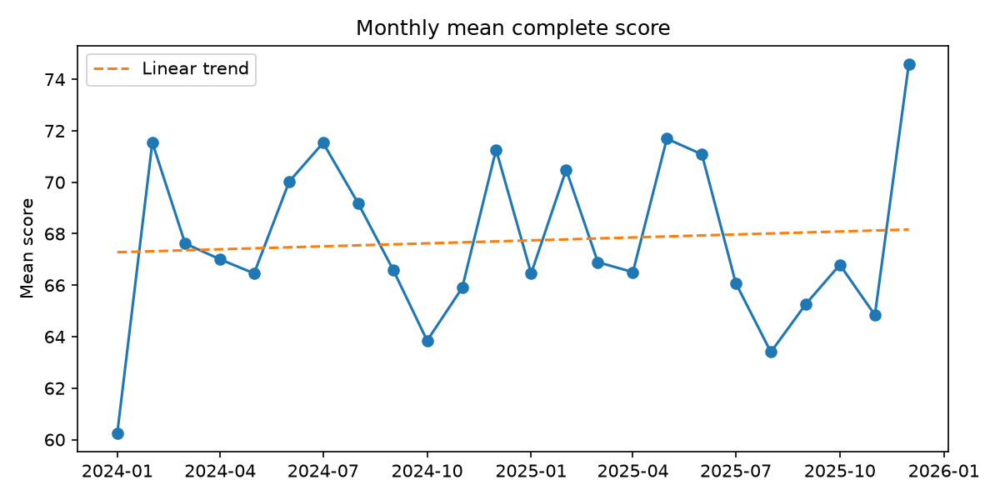

## 14. Statistical data visualization

Created histogram, group boxplot, scatterplot, and time-series line chart with labeled axes; choose charts to match variable types.

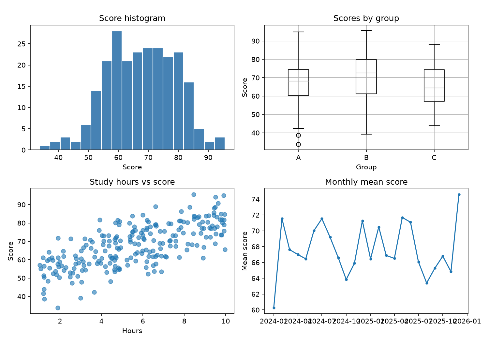

## 15. Data transformation and normalization

Original mean/SD=(67.722, 11.513); z-score mean/SD=(4.74e-16, 1.000); min-max range=(0.0, 1.0).

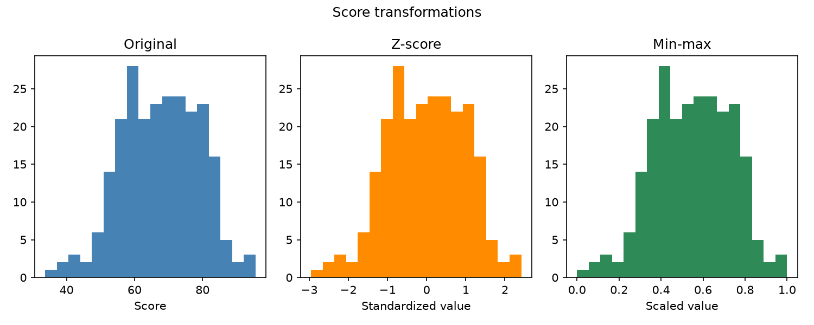

## 16. ANOVA and experimental design

Group means={'A': 67.296, 'B': 70.502, 'C': 65.601}; F(2,237)=3.4613; p=0.0329841; ANOVA table:
              sum_sq     df       F  PR(>F)
C(group)    899.0703    2.0  3.4613   0.033
Residual  30780.1353  237.0     NaN     NaN
Tukey HSD:
Multiple Comparison of Means - Tukey HSD, FWER=0.05 
====================================================
group1 group2 meandiff p-adj   lower   upper  reject
----------------------------------------------------
     A      B   3.2064  0.174 -1.0102  7.4231  False
     A      C  -1.6951 0.6033 -5.8626  2.4723  False
     B      C  -4.9016 0.0275 -9.3668 -0.4364   True
----------------------------------------------------
At alpha=0.05, the omnibus test indicates group means differ. Interpret with ANOVA assumptions and nonrandom group assignment in mind.

## 17. Chi-square and categorical data analysis

Observed table (columns 0=not pass, 1=pass):
passed  0.0  1.0
group           
A        19   70
B        16   52
C        23   46
Expected counts:
passed    0.0    1.0
group               
A       22.84  66.16
B       17.45  50.55
C       17.71  51.29
chi-square(2)=3.1587; p=0.206111. No statistically significant association detected at alpha=0.05. Assess expected counts and remember association is not causation.

## 18. Logistic regression

Intercept=-9.1940; coefficients=[0.8928 0.0797]; odds ratios=[2.4421 1.083 ]; predicted pass probability at median predictors=0.8693; predictors=study_hours, attendance_pct; apparent confusion matrix (rows/columns 0,1)=[[36, 20], [12, 148]]; accuracy=0.852; precision=0.881; recall=0.925; F1=0.902. Training-set performance is optimistic; validate on held-out data.

## 19. Non-parametric statistical methods

Female n=130, median=67.44; male n=110, median=68.11; Mann-Whitney U=7033.00, p=0.82790; Welch t=-0.1965, p=0.84439. The rank test does not detect a distributional difference at alpha=0.05. The rank test compares distributions, not necessarily medians alone.

## 20. Bootstrap and resampling methods

Resamples=5,000; bootstrap mean=67.708; bootstrap SE=0.738; percentile 95% CI=(66.293, 69.150). Bootstrap cannot remove sampling bias.

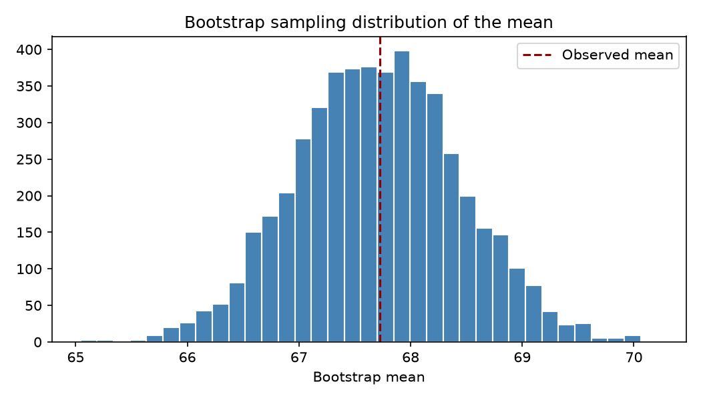

## 21. Multivariate statistical analysis

Variables=(study_hours, attendance_pct, score_complete); correlation matrix:
[[ 1.    -0.115  0.703]
 [-0.115  1.     0.235]
 [ 0.703  0.235  1.   ]]
covariance matrix:
[[  6.605  -3.969  20.886]
 [ -3.969 178.994  36.375]
 [ 20.886  36.375 133.473]]
Standardized k-means cluster counts=[77, 84, 69]. Cluster IDs are arbitrary and depend on scaling and initialization.

## 22. Missing-data analysis and imputation

Missing counts:
study_hours       10
attendance_pct     0
score             14
Missing values imputed per column={'study_hours': 10, 'attendance_pct': 0, 'score': 14}; observed score mean=67.892; score mean after median imputation=67.909. Median imputation is illustrative and understates uncertainty.

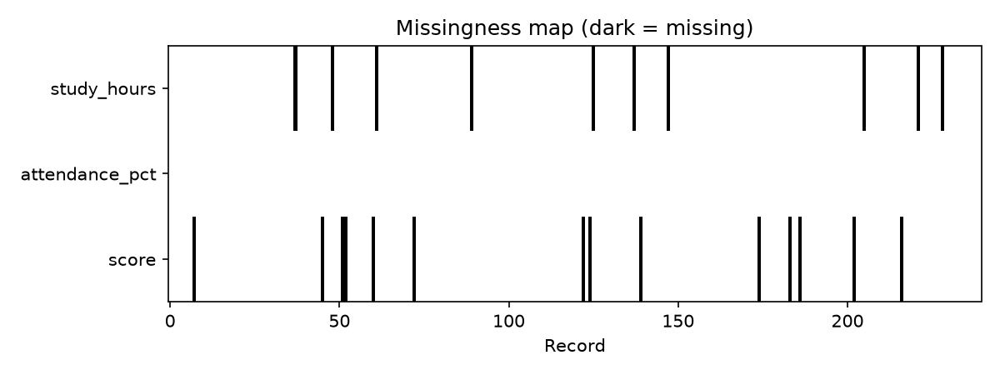

## 23. Statistical reporting and reproducible analysis

The runner records methods and generated results topic by topic, uses fixed random seeds, reads the shared CSV, and saves figures alongside this report. For a submission, include this report, the topic guide, and both source runners in the group's GitHub repository.

## Overall conclusion and limitations

In this generated dataset, study hours and attendance are positively associated with assessment score, and the fitted models summarize those relationships. Group-level tests provide mixed evidence, illustrating why effect estimates, assumptions, and post-hoc comparisons matter. All records are synthetic, models are demonstrations rather than causal claims, and the reported training-sample classification metrics are not out-of-sample performance estimates.
